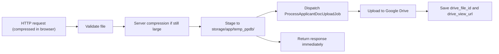
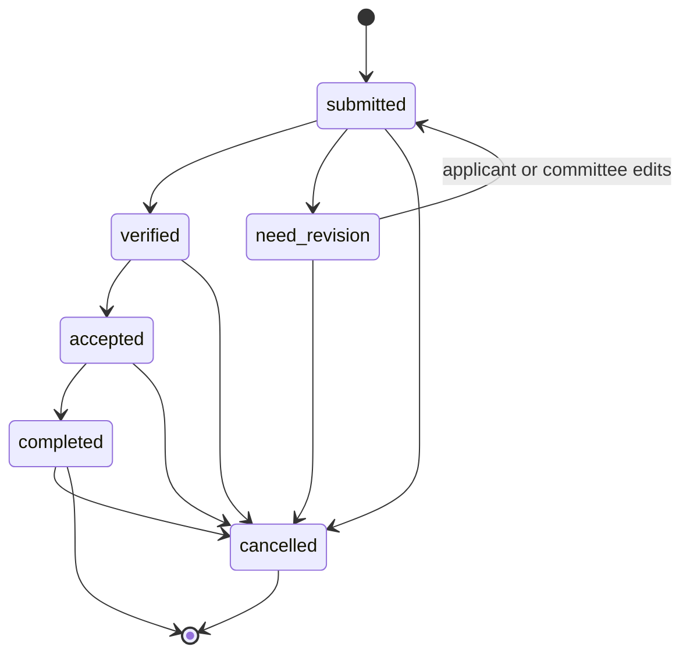

# Context: PPDB Multi-Tenant Engine

Read this before changing any code. It explains what the system is for and which rules must never break.

## Quick Facts

| Item | Value |
| :--- | :--- |
| Type | Standalone multi-tenant PPDB (student admission) engine |
| Architecture | Single Laravel 12 monolith |
| UI | Blade + Alpine.js + Tailwind CSS |
| Database | Shared `saas_core`, linked to the existing `schools` table |
| Tenant key | `school_code` (string, e.g. `sman1jakarta`) |
| Queue | Redis + Laravel Horizon |
| File storage | Google Drive API v3 (one central OAuth 2.0 account) |

---

## 1. Purpose and Philosophy

**Adaptation bridge, not a single source of truth.** The platform connects a school's existing paper-based admission process with online self-service. It does not force every school to go fully digital on day one.

### Dual-Entry Model

| Entry | Who | Where | Notes |
| :--- | :--- | :--- | :--- |
| **Online self-service** | Parents / prospective students | Public multi-step wizard | Flexible hybrid: document upload from home or choose to bring physical hardcopy directly to school (`is_physical_submitted`). |
| **Walk-in desk (Mode Loket)** | School staff | CMS `/cms/ppdb/walk-in` | Relaxed validation, staff types in data from physical documents. |

Both entries create the same `ppdb_applicants` record. The column `registration_origin` (`online` / `offline_walk_in`) records which one was used.

---

## 2. Multi-Tenancy

- Every domain model carries `school_id` and is filtered by a global `TenantScope`.
- Tenant resolution happens in the `IdentifyTenantPpdb` middleware and supports:
  - the platform's default path-based routing, and
  - external custom domains (CNAME).
- `withoutGlobalScopes()` is only allowed in tenant resolution and uniqueness checks.

---

## 3. Access Control

| Actor | Auth Method | Permissions |
| :--- | :--- | :--- |
| **Applicant / public** | No password. `registration_number` + `birth_date` (or `nik`). | View status, download slip, re-upload rejected documents. |
| **Committee (Panitia)** | Email + password in `ppdb_users`, scoped to `school_id`. | Everything in the school's CMS. One tier only, no role-permission matrix. |

---

## 4. Anti-Lost Slip Invariant (3-Layer Safety Net)

Parents must never lose their registration number. Every successful registration triggers all three layers:

| Layer | Name | Behavior |
| :---: | :--- | :--- |
| 1 | Direct device download | The browser silently downloads the slip PDF right after submit. |
| 2 | WhatsApp self-share | A `wa.me` link sends the registration number, birth date, and status link to the parent's own WhatsApp. No API cost. |
| 3 | Desk backup | The admin dashboard has one-click reprint and WhatsApp resend for each applicant. |

---

## 5. Documents and Storage

- **Model Penyimpanan Mandiri (Bring Your Own Drive - BYOD):**
  - Setiap sekolah (tenant) menghubungkan akun Google Drive mereka sendiri (Google Workspace for Education / Gmail sekolah).
  - Platform SaaS hanya bertindak sebagai OAuth Client App (`GOOGLE_DRIVE_CLIENT_ID` dan `GOOGLE_DRIVE_CLIENT_SECRET` di `.env`).
  - `refresh_token` disimpan terenkripsi (`Crypt::encryptString`) pada kolom `schools.google_drive_refresh_token`.
  - Panel koneksi / diskoneksi mandiri tersedia di CMS (`/cms/settings/google-drive`).
- Folder layout di dalam Google Drive milik masing-masing sekolah:

```text
[Akun Google Drive Sekolah Masing-Masing]/
└── [Root Folder / PPDB Root]/
    └── PPDB_{YEAR}/
        └── {REG_NO}_{APPLICANT_NAME}/
```

- Image compression happens in two layers:

| Layer | Where | Purpose |
| :---: | :--- | :--- |
| 1 | Browser (client) | Compress before sending to save the parent's mobile data and speed up the upload. |
| 2 | `DocumentCompressionService` (server) | Safety net. Shrinks any large image that skipped client compression (for example uploads from the "Daftar di Loket" screen) before it goes to Google Drive. |

- Upload flow:



---

## 6. UI Terminology

Admin and public screens never show raw database or programming terms.

| Technical | Shown to Users | Never Use |
| :--- | :--- | :--- |
| `is_required = true` | Wajib Diisi | |
| `is_required = false` | Boleh Dikosongkan / Menyusul | |
| `is_physical_submitted` | Berkas fisik diterima langsung (CMS / Loket) / Tunjukkan berkas fisik langsung ke sekolah (Publik) | |
| `offline_walk_in` | Daftar di Loket | Manual Input, Walk-in |
| `need_revision` | Perlu Perbaikan | Ditolak, Berkas Cacat |

Status labels are listed in [§8](#8-applicant-status-flow).

---

## 7. Form Model (Hybrid)

- **Core identity fields** (name, NIK, birth date, WhatsApp, etc.) are real columns on `ppdb_applicants`.
- **School-specific fields** live in the `custom_fields` JSON column, defined by `ppdb_form_fields`.
- New schools start from a preset per school level. See [`docs/form-presets.md`](docs/form-presets.md).

---

## 8. Applicant Status Flow



| Status | UI Label | Meaning |
| :--- | :--- | :--- |
| `submitted` | Terdaftar | Set automatically on submit, and again after a revision (back in the queue). |
| `need_revision` | Perlu Perbaikan | Committee asked for a re-upload or clarification (blurry or missing file). |
| `verified` | Berkas Lengkap | Documents and physical files confirmed valid. |
| `accepted` | Diterima | Student admitted within the quota. |
| `completed` | Selesai Daftar Ulang | Re-registration done (measurements, fees, in-person visit). |
| `cancelled` | Dibatalkan | Applicant withdrew or was dropped. Reachable from any status. |

**Paths:**
- **Normal:** `submitted` → `verified` → `accepted` → `completed`.
- **Revision:** `submitted` → `need_revision` → (applicant or committee edits) → `submitted`.
- **Cancellation:** any status → `cancelled`.

**Committee tolerance:** the diagram describes the normal flow, not a hard rule. The CMS backend must **not** enforce a strict state machine. The committee may flip toggles back and forth to fix a misclick at the desk. Status changes happen through inline toggle switches on the admin table. There is no Excel import cycle.
