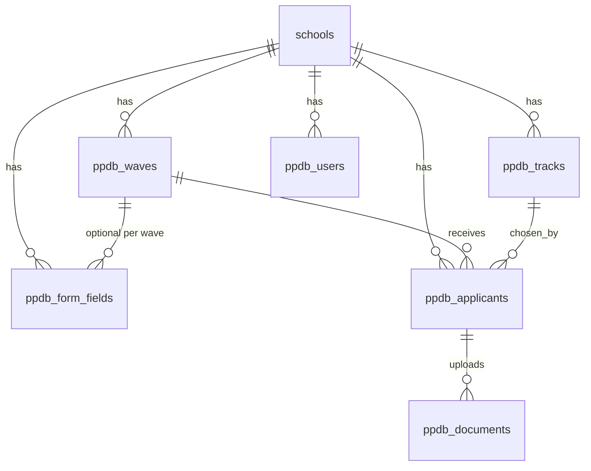

# Database Schema

All `ppdb_*` tables live in the shared `saas_core` database. Every table except the global `schools` table has `school_id` and is filtered by `TenantScope`.

## Relationships

> [!IMPORTANT]
> **Tenant key:** `school_id` on every `ppdb_*` table (`ppdb_waves`, `ppdb_tracks`, `ppdb_form_fields`, `ppdb_applicants`, `ppdb_documents`, `ppdb_users`) is `VARCHAR(50)` and references `schools.school_code`.
>
> - Migration: `$table->string('school_id', 50)->index();` with a foreign key to `schools.school_code`.
> - **Forbidden:** `unsignedBigInteger('school_id')`, `foreignId('school_id')`, or any relation to `schools.id`.

## Common Columns

| Column | Type | Notes |
| :--- | :--- | :--- |
| `id` | BIGINT UNSIGNED, PK, auto increment | Every table. |
| `school_id` | VARCHAR(50), indexed, FK → `schools.school_code` | Every tenant table. |
| `created_at`, `updated_at` | TIMESTAMP | Every table. |

The tables below list only the columns specific to each table.

---

## `ppdb_waves`: Admission Periods

Academic year, registration window, and the emergency on/off switch.

| Column | Type | Default | Notes |
| :--- | :--- | :--- | :--- |
| `name` | VARCHAR(150) | | e.g. "Gelombang 1 - Jalur Reguler" |
| `academic_year` | VARCHAR(20) | | e.g. "2026/2027" |
| `start_date` | DATETIME | | Public registration opens. |
| `end_date` | DATETIME | | Public registration closes. |
| `announcement_date` | DATETIME, nullable | | Results release. |
| `is_active` | BOOLEAN | `true` | Emergency toggle. |

**Indexes:** `[school_id, is_active]`

---

## `ppdb_tracks`: Admission Tracks and Quotas

| Column | Type | Default | Notes |
| :--- | :--- | :--- | :--- |
| `name` | VARCHAR(100) | | e.g. Zonasi, Prestasi, Reguler, Tahfidz |
| `slug` | VARCHAR(100) | | Unique within the tenant. |
| `quota` | INT, nullable | | Optional capacity. |
| `description` | TEXT, nullable | | Conditions and required physical documents. |
| `is_active` | BOOLEAN | `true` | Close a single track. |
| `order_index` | INT | `0` | Display order. |

**Indexes:** `[school_id, is_active]`

---

## `ppdb_form_fields`: Dynamic Form Config

| Column | Type | Default | Notes |
| :--- | :--- | :--- | :--- |
| `wave_id` | BIGINT, nullable, FK → `ppdb_waves.id` | | `null` = applies to all waves. |
| `step` | VARCHAR(50) | | `biodata`, `orang_tua`, `asal_sekolah`, `berkas`, `tambahan` |
| `field_key` | VARCHAR(100) | | Key inside `ppdb_applicants.custom_fields`. |
| `field_label` | VARCHAR(150) | | Indonesian label shown on the form. |
| `field_type` | ENUM | | `text`, `number`, `select`, `radio`, `checkbox`, `textarea`, `date`, `file` |
| `options` | JSON, nullable | | Choices for `select` / `radio`. |
| `is_required` | BOOLEAN | `false` | "Wajib Diisi" vs "Boleh Dikosongkan / Menyusul". |
| `is_active` | BOOLEAN | `true` | Show or hide the field. |
| `order_index` | INT | `0` | Order within the step. |

**Indexes:** `[school_id, step, is_active]`

---

## `ppdb_applicants`: Applicants

| Column | Type | Default | Notes |
| :--- | :--- | :--- | :--- |
| `wave_id` | BIGINT, indexed, FK → `ppdb_waves.id` | | |
| `track_id` | BIGINT, nullable, indexed, FK → `ppdb_tracks.id` | | |
| `registration_number` | VARCHAR(50), unique | | `REG-{SCHOOL}-{YEAR}-{INDEX}` |
| `registration_origin` | ENUM | `online` | `online`, `offline_walk_in` |
| `full_name` | VARCHAR(255) | | Legal name. |
| `nik` | VARCHAR(20), indexed | | National ID number. |
| `birth_date` | DATE | | Main public lookup credential. |
| `birth_place` | VARCHAR(100), nullable | | |
| `gender` | ENUM, nullable | | `L`, `P` |
| `phone_whatsapp` | VARCHAR(25) | | Main notification number. |
| `custom_fields` | JSON, nullable | | Answers to dynamic fields. |
| `document_completeness` | ENUM | `incomplete` | `complete_digital`, `complete_physical`, `incomplete`. Set to `complete_physical` when physical submission is chosen online (Cara 2) or at the desk. |
| `status` | ENUM | `submitted` | `submitted`, `need_revision`, `verified`, `accepted`, `completed`, `cancelled` |
| `verification_notes` | TEXT, nullable | | Committee feedback for revisions. |
| `verified_at` | TIMESTAMP, nullable | | |
| `verified_by` | VARCHAR(100), nullable | | Staff name or identifier. |

**Indexes:** `[school_id, status]`, `[registration_number, birth_date]`

---

## `ppdb_documents`: Uploaded Files

| Column | Type | Default | Notes |
| :--- | :--- | :--- | :--- |
| `applicant_id` | BIGINT, FK → `ppdb_applicants.id`, cascade on delete | | |
| `document_type` | VARCHAR(50) | | e.g. `kk`, `akta_kelahiran`, `ijazah`, `pas_foto`, `sertifikat` |
| `original_file_name` | VARCHAR(255), nullable | | Nullable when physical submission is chosen without uploading a digital file. |
| `drive_file_id` | VARCHAR(255), nullable | | Filled by the upload job. |
| `drive_view_url` | TEXT, nullable | | Google Drive preview link. |
| `is_physical_submitted` | BOOLEAN | `false` | Hardcopy received/verified by committee at the office. |
| `verification_status` | ENUM | `pending` | `pending`, `valid`, `invalid` |
| `rejection_reason` | VARCHAR(255), nullable | | Shown to the applicant on the status page. |

**Indexes:** `[applicant_id, document_type]`

---

## `ppdb_users`: Committee Staff

Single-tier login for the admissions committee. No roles.

| Column | Type | Default | Notes |
| :--- | :--- | :--- | :--- |
| `name` | VARCHAR(255) | | |
| `email` | VARCHAR(255) | | Unique per school. |
| `password` | VARCHAR(255) | | Bcrypt hash. |
| `remember_token` | VARCHAR(100), nullable | | |

**Indexes:** `[school_id, email]`

---

## `schools`: Tenant Registry & Google Drive BYOD Columns

Extends the shared `schools` table in `saas_core` for per-school Google Drive storage:

| Column | Type | Default | Notes |
| :--- | :--- | :--- | :--- |
| `google_drive_refresh_token` | TEXT, nullable | | OAuth refresh token, wajib dienkripsi aplikasi via `Crypt::encryptString`. |
| `google_drive_email` | VARCHAR(255), nullable | | Akun Google Workspace / Gmail yang terhubung. |
| `google_drive_root_folder_id` | VARCHAR(255), nullable | | ID folder induk opsional jika ingin menyimpan di subfolder tertentu. |

