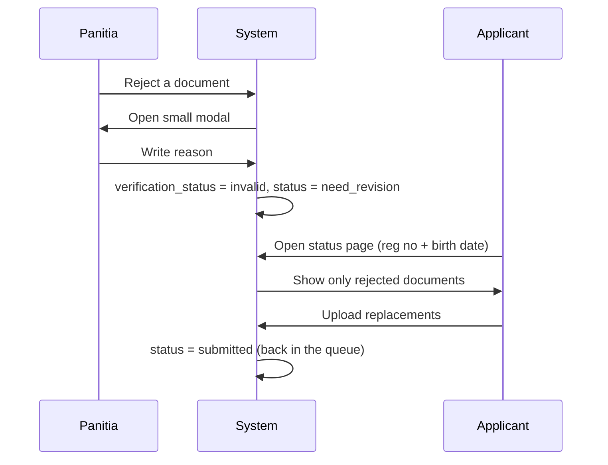

# Feature Modules

| Module | Name | Main Classes |
| :---: | :--- | :--- |
| A | Dual-Entry Registration | `RegistrationWizardController`, `WalkInDeskController` |
| B | Registration Slip (Safety Net) | `GenerateApplicantPdfCardJob`, `SafetyProofModal` |
| C | Admin Table and Toggles | `ApplicantTableController`, `ApplicantActionToggleController`, `StatusToggleSwitch` |
| D | Bring Your Own Drive (BYOD) | `GoogleDriveSettingController`, `GoogleDriveClientService` |

---

## Module A: Dual-Entry Registration

### A1. Online Self-Service

| Step | Content |
| :---: | :--- |
| 1 | Choose a track and read its conditions. |
| 2 | Student identity and parent/guardian details. |
| 3 | School-specific custom fields (rendered by `DynamicInputRenderer`). |
| 4 | Document uploads with flexible hybrid option (Cara 2: choose digital upload or present physical documents directly at school). |

- **Flexible Hybrid Document Option (Cara 2):** Applicants can check *"Tunjukkan berkas fisik langsung ke sekolah (tanpa unggah file)"* (`is_physical_submitted = 1`). When active:
  - Client-side Alpine.js removes the `required` attribute from file inputs.
  - Server-side `FormSchemaValidatorService` sets file rules to `nullable`, allowing applicants to skip file uploads.
  - Initial `document_completeness` is set to `complete_physical`.
  - Placeholder `PpdbDocument` records are created with `verification_status = 'pending'`, so the applicant status page displays the physical checklist they must bring, and committee staff in the CMS can verify each document with the `+ Terima Fisik` toggle.
- Images are compressed in the browser before upload (layer 1). `DocumentCompressionService` catches anything still large (layer 2).
- Validation: `StoreApplicantPublicRequest` + rules from `FormSchemaValidatorService`.
- Protected by `EnsureRegistrationPeriodOpen`.
- Saving the applicant, its document rows, and the temp file release runs in one `DB::transaction`.

### A2. Walk-In Desk (Mode Loket)

- CMS only: `/cms/ppdb/walk-in`.
- Short form with relaxed validation for fast intake.
- Checkbox **"Berkas fisik diterima langsung"** sets `is_physical_submitted`.
- One click prints an intake slip for the parent.
- Validation: `StoreApplicantWalkInRequest`.
- Saved with `registration_origin = offline_walk_in`, shown as **"Daftar di Loket"**.
- Files uploaded here often skip browser compression, so `DocumentCompressionService` must shrink them on the server.

---

## Module B: Registration Slip (Safety Net)

Implements the 3-layer rule in [`context.md` §4](../context.md#4-anti-lost-slip-invariant-3-layer-safety-net).

### B1. Slip PDF
- A4/A5 layout from `pages/pdf/applicant_card_slip.blade.php`.
- Contains: school branding, applicant details, track, QR/barcode verification hash, next-step instructions.

### B2. Auto Download
- After a successful submit, JavaScript creates a hidden anchor and triggers the PDF download. No page reload.

### B3. WhatsApp Self-Share
- Plain-text message with: applicant name, registration number, birth date, status page URL.
- Opens `https://wa.me/?text={encoded_message}` in a new tab or the WhatsApp app on mobile.

---

## Module C: Admin Table and Toggles

### C1. Inline Toggles

The committee changes status from the table row with Alpine.js switches. Each click sends an async PATCH; the table does not reload.

Toggles work in both directions. The backend must not block a change for being "out of order", so a misclick can be undone with another click.

| Toggle | Labels |
| :--- | :--- |
| Document validity | Lengkap / Belum |
| Admission decision | Diterima / Proses |
| Re-registration | Selesai / Belum |

### C2. Revision Flow

Example reason: *"Foto Akta terpotong di bagian nomor registrasi, mohon unggah ulang."*

---

## Module D: Bring Your Own Drive (BYOD) Google Drive Per-Sekolah

Penyimpanan berkas pendaftar dialihkan ke akun Google Drive milik sekolah masing-masing (Google Workspace for Education / Gmail sekolah):

### D1. OAuth Connect & Disconnect Mandiri
- Panel konfigurasi: `/cms/settings/google-drive`.
- Sekolah menekan tombol **"Hubungkan Akun Google Drive"** dan menyetujui izin via consent screen resmi Google.
- `refresh_token` disimpan secara aman dan otomatis dienkripsi dengan `Crypt::encryptString` ke kolom `schools.google_drive_refresh_token`.
- Panitia sekolah dapat memutus sambungan (disconnect) sewaktu-waktu atau mengganti akun.

### D2. Hirarki Folder Terisolasi
Di dalam Drive sekolah, berkas ditata otomatis:
- `PPDB_{TAHUN}` / `{NOMOR_REGISTRASI}_{NAMA_PENDAFTAR}` / `[berkas]`.
- Opsional: Sekolah dapat menentukan `google_drive_root_folder_id` jika ingin menempatkan seluruh data PPDB di folder spesifik.

### D3. Eksekusi Asinkron Berbasis Tenant
- Antrean background `ProcessApplicantDocUploadJob` membawa identitas `school_id`.
- Service resolver `GoogleDriveClientService` mengambil kredensial unik sekolah bersangkutan tanpa pernah mencampuradukkan berkas antar tenant.

