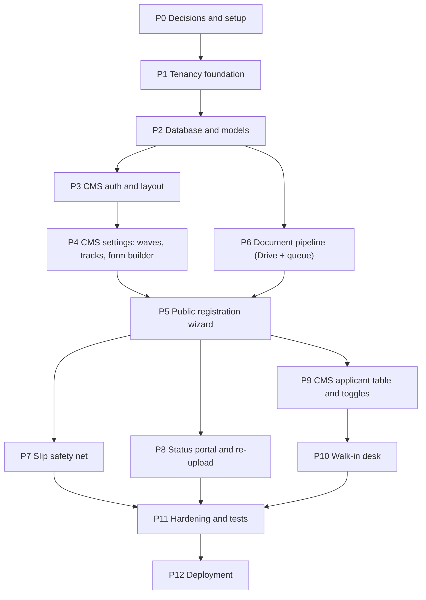

# Implementation Plan

Build order for the PPDB engine, from an empty folder to production. Each phase lists its goal, tasks, output, and a "done when" check. Do not start a phase until the phases it depends on are done.

Rules from [`AGENTS.md`](../AGENTS.md) apply to every phase (file limits, tenant scope, transactions, no SPA).

---

## Overview

| Phase | Name | Depends On | Size | Status |
| :---: | :--- | :--- | :---: | :---: |
| P0 | Decisions and setup | none | S | [DONE] |
| P1 | Tenancy foundation | P0 | M | [DONE] |
| P2 | Database and models | P1 | M | [DONE] |
| P3 | CMS auth and layout | P2 | S | [DONE] |
| P4 | CMS settings (waves, tracks, form builder) | P3 | L | [DONE] |
| P5 | Public registration wizard | P4, P6 | L | [DONE] |
| P6 | Document pipeline | P2 | M | [DONE] |
| P7 | Slip safety net | P5 | M | [DONE] |
| P8 | Status portal and re-upload | P5 | M | [DONE] |
| P9 | CMS applicant table and toggles | P5 | L | [DONE] |
| P10 | Walk-in desk | P9 | S | [DONE] |
| P11 | Hardening and tests | P7, P8, P10 | M | [DONE] |
| P12 | Deployment | P11 | S | [DONE] |

---

## P0. Decisions and Setup

**Goal:** a running Laravel 12 skeleton connected to `saas_core`, with no risk of clashing with the existing platform.

### Decisions needed before coding

| # | Topic | Proposal | Why it matters |
| :-: | :--- | :--- | :--- |
| D1 | Laravel migrations table | `config/database.php` → `'migrations' => ['table' => 'ppdb_migrations']` | The shared `saas_core` DB probably already has a `migrations` table from the main platform. |
| D2 | Session, cache, queue storage | Redis for all three | Avoids creating `sessions`, `cache`, `jobs`, `failed_jobs` tables that may already exist in `saas_core`. If a DB table is still needed, prefix it `ppdb_`. |
| D3 | `schools` table ownership | Read-only from PPDB. No migration touches it. | It belongs to the main platform. |
| D4 | PDF library | `barryvdh/laravel-dompdf` | Slip rendering from a Blade view. |
| D5 | Google Drive client | `google/apiclient` | OAuth refresh token + Drive v3 multipart upload. |
| D6 | Server image compression | `intervention/image` | Layer 2 compression. |
| D7 | QR code on slip | `simplesoftwareio/simple-qrcode` or plain SVG generator | Verification hash on the slip. |
| D8 | Browser compression | Vanilla canvas resize in a small Alpine helper (no npm package) | Keeps the frontend dependency-free. |
| D9 | Queue dashboard | `laravel/horizon` | Already chosen in `context.md`. |
| D10 | Registration sequence lock | See [Risk R1](#risks) | `lockForUpdate()` on an empty result locks nothing. |

> Every package above is a dependency change and needs explicit approval before install.

### Tasks
1. Create the Laravel 12 project in this folder (docs stay as they are).
2. Configure `.env`: `saas_core` connection, Redis, `APP_URL`, Google credentials placeholders.
3. Apply D1 and D2.
4. Set up Vite + Tailwind CSS + Alpine.js.
5. Install approved packages (D4–D9).
6. Add Laravel Pint config and a basic PHPUnit setup with a separate test database.

**Done when:** `php artisan migrate` creates only `ppdb_migrations` in `saas_core`, the welcome page loads, and Vite builds Tailwind + Alpine.

---

## P1. Tenancy Foundation

**Goal:** every request knows which school it belongs to, and every tenant model filters itself.

### Tasks
1. `School` model, read-only, mapped to the existing `schools` table, keyed by `school_code`.
2. `TenantContextService` (singleton): holds the active `School`, getters for `school_code`, name, logo, config, and `isCustomDomain()`.
3. `IdentifyTenantPpdb` middleware:
   - custom domain: look up the host (`ppdb.sekolah.sch.id`) in the school domain mapping;
   - default: read `{school_code}` from `ppdb.bitserver.cloud/{school_code}`;
   - unknown tenant → 404 page.
4. `TenantScope` global scope: `where school_id = current school_code`.
5. `BelongsToTenant` trait: registers `TenantScope` and fills `school_id` on `creating`. Never from request input.
6. Tenant URL helper (`tenant_route()` or similar) that produces the right URL for both modes.
7. Route file layout: one route group registered twice (domain group + prefix group) that points to the same controllers.

**Output:** `app/Models/School.php`, `app/Services/TenantContextService.php`, `app/Http/Middleware/IdentifyTenantPpdb.php`, `app/Scopes/TenantScope.php`, trait, helper, `routes/web.php`.

**Done when:** feature tests prove that
- school A cannot read school B's rows,
- `school_id` is filled automatically,
- the same page works on a custom domain and on the path prefix.

---

## P2. Database and Models

**Goal:** all `ppdb_*` tables from [`database-schema.md`](database-schema.md) exist with models, factories, and presets.

### Tasks
1. Migrations, in this order: `ppdb_waves`, `ppdb_tracks`, `ppdb_form_fields`, `ppdb_users`, `ppdb_applicants`, `ppdb_documents`.
   - `school_id` = `string('school_id', 50)->index()` + FK to `schools.school_code`.
   - Enum values exactly as in the schema (`offline_walk_in`, status list, etc.).
2. Models with `BelongsToTenant`, casts (`custom_fields`, `options` as array; dates), relationships. Max 100 lines each.
3. Factories for every model (used by tests and demo data).
4. `FormPresetSeederService` with the four blueprints from [`form-presets.md`](form-presets.md).
5. Demo seeder: one test school, one wave, two tracks, one committee user, preset form.

**Done when:** migrations run up and down cleanly on a copy of `saas_core`, and the demo seeder produces a usable school.

---

## P3. CMS Auth and Layout

**Goal:** committee staff can log in and see an empty dashboard for their school only.

### Tasks
1. Separate auth guard `ppdb` using `ppdb_users` (session, bcrypt).
2. Login is tenant-aware: email + password checked inside the current school.
3. Login / logout pages, password reset optional (decide later).
4. `ppdb_cms.blade.php` layout: sidebar (Dashboard, Gelombang, Jalur, Formulir, Pendaftar, Loket), header with school logo.
5. `dashboard_overview` with placeholder counters.
6. Route group `/cms/ppdb/*` protected by `auth:ppdb` + `IdentifyTenantPpdb`.

**Done when:** a user from school A cannot log in on school B's URL, and all CMS routes redirect guests to login.

---

## P4. CMS Settings

**Goal:** the committee can prepare a full admission period without developer help.

### P4a. Waves (`SettingPeriodController`)
- List, create, edit, toggle `is_active`.
- `UpdatePeriodSettingRequest`: `end_date` after `start_date`, announcement optional.

### P4b. Tracks (`TrackManagementController`)
- List, create, edit, reorder (`order_index`), toggle active, optional quota.
- Slug generated per tenant.

### P4c. Form builder (`FormBuilderController`)
- "Pakai template" button → `FormPresetSeederService` by school level.
- Fields grouped by step (`biodata`, `orang_tua`, `asal_sekolah`, `berkas`, `tambahan`).
- Add / edit / hide / reorder fields; options editor for select and radio.
- Labels use school wording: "Wajib Diisi" / "Boleh Dikosongkan / Menyusul".
- Optional per-wave fields (`wave_id`).

**Done when:** starting from an empty school, staff can create a wave, two tracks, and a working form using only the CMS.

---

## P5. Public Registration Wizard

**Goal:** a parent can register from a phone and leave with a registration number.

### Tasks
1. `LandingController` + `landing.blade.php`: school info, open waves, tracks with conditions.
2. `EnsureRegistrationPeriodOpen` on wizard routes; closed page when outside the window.
3. `RegistrationWizardController` + `register_step_container.blade.php`:
   - Step 1 track, Step 2 identity + parents, Step 3 custom fields, Step 4 documents.
   - `WizardStepper` and `DynamicInputRenderer` components.
   - Draft state kept in the browser (Alpine) so a refresh does not lose input.
4. Browser image compression helper (layer 1).
5. `FormSchemaValidatorService` builds rules for `custom_fields`; `StoreApplicantPublicRequest` merges core + dynamic rules.
6. `RegistrationNumberService` (`REG-{SCHOOL}-{YEAR}-{INDEX}`), inside `DB::transaction` with locking.
7. Submit flow in one transaction:
   - insert `ppdb_applicants`,
   - insert `ppdb_documents` rows (`pending`, no Drive ID yet),
   - move files to `storage/app/temp_ppdb/`,
   - after commit, dispatch `ProcessApplicantDocUploadJob` per file.
8. Response returns what P7 needs: registration number, slip URL, WhatsApp text.

**Done when:** a registration on a slow mobile connection finishes without waiting for Drive, and two parallel submissions never get the same number.

---

## P6. Document Pipeline & BYOD Google Drive Per-Sekolah

**Goal:** files reach each school's own Google Drive in the background, reliably.

### Tasks
1. `GoogleDriveSettingController` + `google_drive_settings.blade.php`: panel CMS sekolah untuk menghubungkan akun Google Drive mandiri (OAuth 2.0 flow, offline access, consent prompt), menyimpan `refresh_token` terenkripsi dengan `Crypt::encryptString` ke `schools.google_drive_refresh_token`.
2. `GoogleDriveClientService`: resolver dinamis token per `school_id`, rotasi access token menggunakan client ID & secret platform, pembuatan struktur folder otomatis di akun sekolah (`PPDB_{YEAR}/{REG_NO}_{NAME}`), dan multipart upload Drive API v3.
3. `DocumentCompressionService`: shrink images above a size/dimension threshold (Intervention Image); skip PDFs.
4. `ProcessApplicantDocUploadJob`: menerima konteks `schoolCode`, baca staging lokal `storage/app/temp_ppdb/` → kompresi server jika perlu → upload via `GoogleDriveClientService` ke Drive sekolah bersangkutan → simpan `drive_file_id` + `drive_view_url` → hapus file temporer lokal. Set `tries`, `backoff`, dan `failed()` (simpan file temp jika gagal total untuk manual recovery).
5. Horizon config: dedicated `documents` queue.
6. Scheduled cleanup untuk file temp lokal yatim piatu.

**Done when:** setiap sekolah dapat menghubungkan Google Drive masing-masing via CMS, token tersimpan aman terenkripsi, berkas pendaftar terunggah ke Drive sekolah yang tepat tanpa benturan antar tenant, dan 100% tes lolos.

---

## P7. Slip Safety Net

**Goal:** all three layers from [`context.md` §4](../context.md#4-anti-lost-slip-invariant-3-layer-safety-net) work.

### Tasks
1. `applicant_card_slip.blade.php` (A4/A5): school branding, applicant data, track, QR verification hash, next steps.
2. Slip download route, authorized by registration number + birth date (or a signed URL).
3. Layer 1: `SafetyProofModal` after submit, auto-triggers the PDF download via hidden anchor.
4. Layer 2: WhatsApp button `https://wa.me/?text=...` with name, reg number, birth date, status URL.
5. Layer 3: reprint and WhatsApp resend in `QuickActionMenu` (wired in P9).
6. `GenerateApplicantPdfCardJob` only if async PDF or email is needed (optional).

**Done when:** after submit, the PDF downloads without a reload and the WhatsApp link opens with a correct message on Android and iOS.

---

## P8. Status Portal and Re-Upload

**Goal:** parents check status and fix rejected documents without a password.

### Tasks
1. `ApplicantStatusController` + `status_tracker.blade.php`: lookup by registration number + birth date (or NIK).
2. Rate limit lookups per IP and per registration number.
3. Show status label (Terdaftar, Perlu Perbaikan, Berkas Lengkap, Diterima, Selesai Daftar Ulang, Dibatalkan) and committee notes.
4. When `need_revision`: show only `invalid` documents with their `rejection_reason`, allow re-upload, then set status back to `submitted` (in a transaction).
5. Slip re-download from this page.

**Done when:** a wrong birth date never reveals data, and a re-upload replaces only the rejected file.

---

## P9. CMS Applicant Table and Toggles

**Goal:** the committee manages all applicants from one table.

### Tasks
1. `ApplicantTableController` + `applicant_index.blade.php`: pagination, search (name, reg number, NIK), `TrackFilterTabs`, filter by status and origin.
2. `StatusToggleSwitch` (Alpine) for: document validity, admission decision, re-registration. Async PATCH to `ApplicantActionToggleController`, no reload, both directions allowed.
3. `applicant_detail.blade.php`: data, custom fields, documents with Drive preview, physical-document checkbox.
4. Document rejection modal → `verification_status = invalid`, reason, applicant `need_revision` (transaction).
5. `QuickActionMenu`: reprint slip, WhatsApp resend, cancel.
6. Dashboard counters from P3 filled with real numbers per status and track.
7. Optional: export to Excel/CSV (decide later, not an import cycle).

**Done when:** a misclick can be undone with one more click, and every change is visible after a page refresh.

---

## P10. Walk-In Desk

**Goal:** staff register a parent at the office in under two minutes.

### Tasks
1. `WalkInDeskController` + `walk_in_form.blade.php` at `/cms/ppdb/walk-in`.
2. `StoreApplicantWalkInRequest` with relaxed rules.
3. "Berkas fisik diterima langsung" checkbox → `is_physical_submitted`.
4. Saves `registration_origin = offline_walk_in`, reuses `RegistrationNumberService` and the same transaction flow as P5.
5. Uploaded files go through server compression (layer 2) before Drive.
6. Print intake slip right after save.

**Done when:** a walk-in applicant shows up in the table with the "Daftar di Loket" label and a printable slip.

---

## P11. Hardening and Tests

### Tasks
1. Tests:
   - tenant isolation for every model,
   - registration number concurrency,
   - wizard validation with dynamic fields,
   - upload job success / retry / failure,
   - status lookup and rate limits,
   - toggle endpoints.
2. Security: CSRF on all forms, file type and size validation, MIME sniffing, no internal errors shown to users, signed or credential-checked slip URLs.
3. Logging: registration created, upload job start/finish/fail, status changes (who, when), with `school_id` and `registration_number` as context.
4. Check every file against the line limits in `AGENTS.md`.
5. Mobile check of all public pages on a small Android screen.

**Done when:** the test suite passes, Pint is clean, and no file breaks the line limits.

---

## P12. Deployment

### Tasks
1. Server: PHP 8.2+, Redis, Supervisor running Horizon, cron for `schedule:run`.
2. `.env` production values, Google OAuth refresh token stored on the server only.
3. Wildcard / per-domain SSL for custom CNAME domains.
4. Run migrations on `saas_core` (only `ppdb_*` + `ppdb_migrations`).
5. Smoke test on one pilot school: full online registration, walk-in, revision, toggles.
6. Backup plan: DB backup before first migration, rollback steps written down.

**Done when:** the pilot school completes one real registration end to end.

---

## Risks

| # | Risk | Mitigation |
| :-: | :--- | :--- |
| R1 | `lockForUpdate()` on the last applicant row locks nothing when a school has no applicants yet, so the first two parallel submissions can collide. | Lock the school's active `ppdb_waves` row (or a small `ppdb_sequences` counter table) instead, and keep the unique index on `registration_number` as the final guard. Decide in P0 (D10). |
| R2 | Shared `saas_core` tables clash with Laravel defaults. | D1 and D2. |
| R3 | Google Drive quota or token expiry stops uploads. | Retries with backoff, `failed()` keeps temp files, Horizon alert, manual re-dispatch command. |
| R4 | Parents lose the registration number. | 3-layer slip safety net (P7) + desk backup (P9). |
| R5 | Form builder lets schools create fields that break validation. | `FormSchemaValidatorService` only maps known `field_type` values; unknown types are rejected on save. |
